<div align="center">

# pyplant

**A process plant you can break on purpose.**

A simulated two-tank plant with a soft PLC, a Modbus and OPC UA SCADA stack, a
historian, ISA-18.2 alarm management, fault injection and machine-learning
fault detection, all driven from one GUI.

[](https://github.com/mhmodir/pyplant/actions/workflows/ci.yml)


[Quick start](#quick-start) ·
[Who it is for](#who-it-is-for) ·
[What you can do](#what-you-can-do) ·
[Fault gallery](#fault-gallery) ·
[How it works](#how-it-works) ·
[Results](#results) ·
[Docs](#documentation)

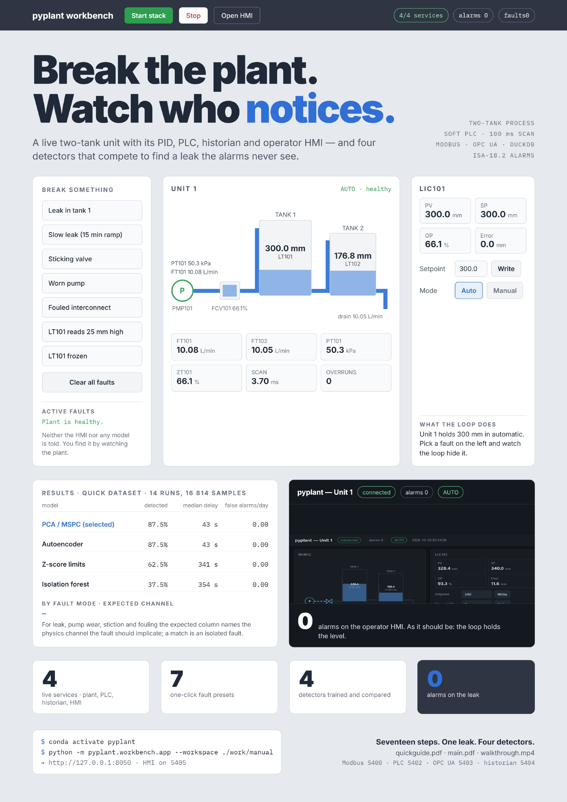


</div>

Everything a real plant has is here, at bench scale: a centrifugal pump
feeding a tank through a control valve, a second tank downstream, a PID loop
holding level, interlocks that trip the pump, and the network between the
field, the controller and the operator. It runs in Python on a laptop, at real
time or up to twenty times faster, and nothing in it needs hardware.

## The fault you cannot see

Open a leak in tank 1 under a working level controller:

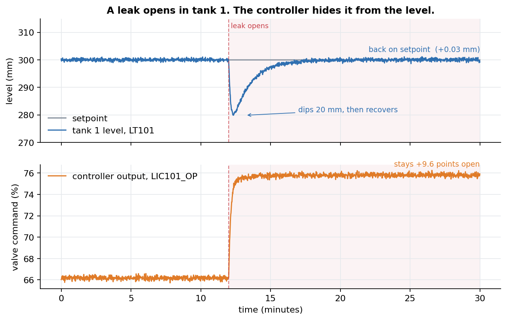

| | tank level | controller output |
| --- | --- | --- |
| before the leak | 300.00 mm | 66.18 % |
| after it settles | **300.00 mm** | **75.80 %** |

The level returns to setpoint exactly. The controller has absorbed the fault,
and its entire signature now lives in the valve position. A detector that
watches only the level cannot see this fault at all.

That is the problem this project is built to study: **in a closed loop, the
controller hides the fault you are looking for.** It is why every detector here
is fed the controller output and three physics residuals alongside the
measurements, and why the operator's alarm list stays empty throughout this
leak. [Why the level comes back](docs/CONTROL.md#why-the-level-comes-back) has
the control theory.

## Quick start

Python 3.11 or newer.

```bash
git clone https://github.com/mhmodir/pyplant.git
cd pyplant
python -m pip install -e ".[ml,ui,dev]"
pyplant-workbench
```

Open <http://127.0.0.1:8050> and work left to right through the tabs:

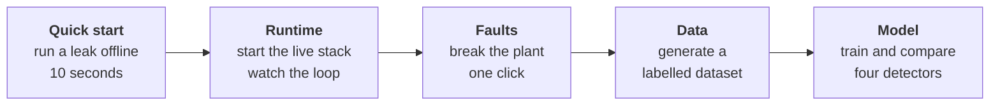

No Python? With Docker, nothing else is needed:

```bash
docker compose up --build        # then open http://localhost:8050
```

The [tutorial](docs/TUTORIAL.md) walks through all five tabs with a screenshot
at every step.

<details>
<summary><b>On Windows</b></summary>

- Use a fresh environment: `conda create -n pyplant python=3.12 -y` then
  `conda activate pyplant`. Check the prompt says `(pyplant)`, not `(base)`.
- If PowerShell refuses to activate conda, run
  `Set-ExecutionPolicy -Scope CurrentUser RemoteSigned` once.
- Keep the speed at 4× or below. Windows schedules sleeps in 15.6 ms steps, so
  above that the PLC misses its 100 ms deadline and, correctly, reports
  overruns.
- In VS Code, `Ctrl+Shift+P` → *Python: Select Interpreter* → the `pyplant`
  environment.

More in [Troubleshooting](docs/DEPLOYMENT.md#troubleshooting).
</details>

## Who it is for

| you are | start with | then try |
| --- | --- | --- |
| **Short on time** | [The fault you cannot see](#the-fault-you-cannot-see) and [Results](#results) | the [poster](docs/pdf/pyplant-poster.pdf) |
| **A student** learning process control | the [tutorial](docs/TUTORIAL.md) | [retuning the loop](docs/CONTROL.md#try-it-retune-the-loop), then every preset in the [fault gallery](#fault-gallery) |
| **A process or controls engineer** | the Runtime and Faults tabs | the operator HMI, or an external OPC UA client such as UaExpert on `opc.tcp://127.0.0.1:5403/pyplant/` |
| **A fault-detection researcher** | [Results](#results), then [DETECTION.md](docs/DETECTION.md) | adding a fifth detector ([how](docs/ARCHITECTURE.md#extending-it)) |
| **A developer** | [ARCHITECTURE.md](docs/ARCHITECTURE.md) | the [design notes](docs/DESIGN_NOTES.md), the tests, a new tag or fault |
| **An instructor** | the [quick-start guide](docs/pdf/pyplant-quickguide.pdf) | one workspace and base port per student ([how](docs/DEPLOYMENT.md#1-the-workbench)) |

## What you can do

| I want to… | where | time |
| --- | --- | --- |
| watch a controller hide a fault | Quick start tab → **Run scenario** | 10 s |
| start a live plant, PLC, historian and HMI | Runtime tab → **Start stack** | 5 s |
| see a PID loop respond to a setpoint change | Runtime tab → LIC101 faceplate → **Write** | 1 min |
| break the running plant | Faults tab → any preset | 1 click |
| compare what instruments report with the truth | Faults tab → ground-truth table | |
| acknowledge and shelve alarms | Runtime tab → Alarms | |
| generate a labelled dataset | Data tab → **Quick** or **Standard** → **Generate** | 45 s to 5 min |
| train and compare four detectors | Model tab → **Train** | about 10 s |
| try different PID tunings | a [short script](docs/CONTROL.md#try-it-retune-the-loop) | seconds |
| read the plant from another tool | OPC UA, `opc.tcp://127.0.0.1:5403/pyplant/` | |
| drive it from code | [`examples/`](examples/) | |
| run it as containers | [Docker](#deployment) | |

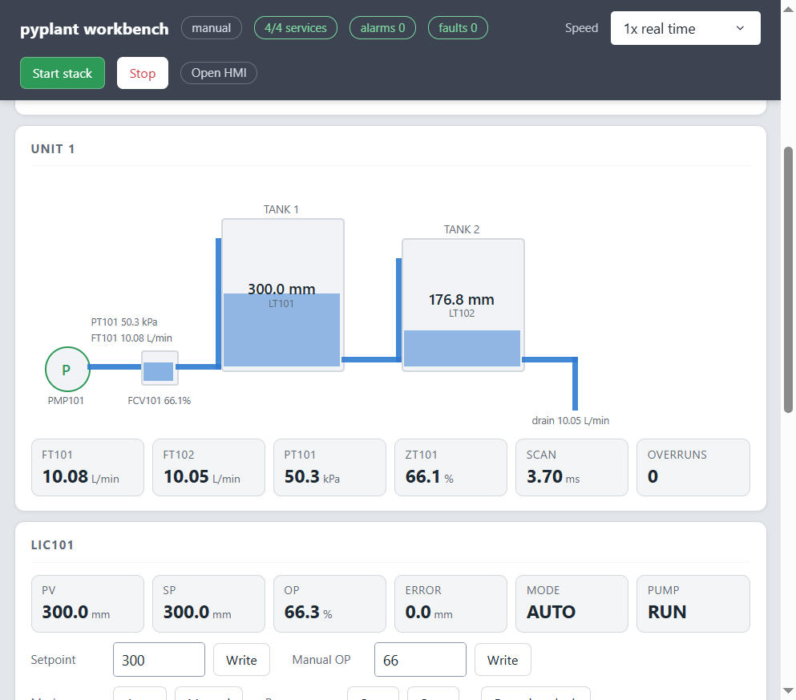

## Fault gallery

Eight fault kinds, each injected into the live plant through an API the
control system cannot see. Each leaves a different fingerprint on the same
signals:

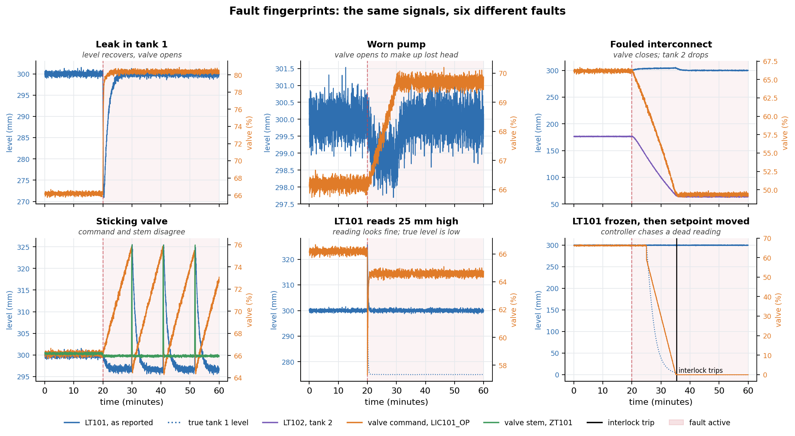

| fault | enters at | what you see | physics channel that isolates it |
| --- | --- | --- | --- |
| **Leak** | the process | level recovers, valve opens, inflow exceeds outflow | `FLOW_IMBALANCE` |
| **Worn pump** | the process | valve opens to make up lost head | `HEAD_RESIDUAL` |
| **Fouled interconnect** | the process | valve closes, tank 2 drains down | `LT102`, `FT102` |
| **Sticking valve** | the actuator | a sawtooth limit cycle; command and stem disagree | `OP_MINUS_ZT` |
| **Sensor bias** | the instrument | the reading looks perfect; the true level is offset | reported separately |
| **Sensor drift** | the instrument | an offset that grows slowly | reported separately |
| **Sensor frozen** | the instrument | a dead reading; move the setpoint and the pump trips | reported separately |
| **Sensor noise** | the instrument | always on, as realism; never labelled a fault | |

Two of these need patience. A sticking valve takes several process time
constants to settle into its limit cycle, so run it at 10× (4× on Windows). A
frozen transmitter sitting on setpoint gives the controller nothing to act on;
change the setpoint after injecting it.

## How it works

### The process

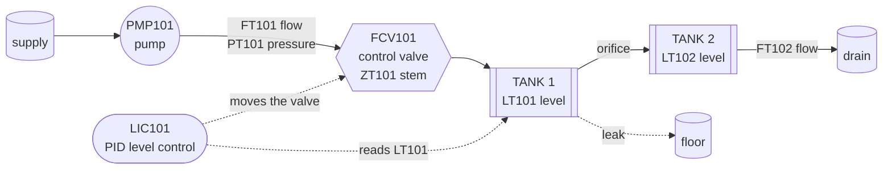

A centrifugal pump feeds tank 1 through an equal-percentage control valve;
tank 1 drains by gravity into tank 2, which drains to atmosphere. LIC101 holds
tank 1 at 300 mm. Tank 2 is uncontrolled, so a fault in tank 1 reaches it with
a lag.

### The control loop

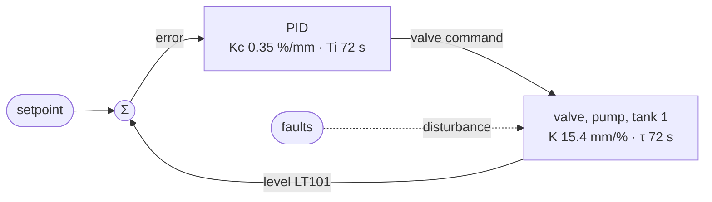

A velocity-form PI controller tuned by internal model control: no overshoot,
settles in about 40 s, zero offset to any step disturbance, which is exactly
why a leak vanishes from the level. Derivation, tuning, and a script for
trying other gains: [CONTROL.md](docs/CONTROL.md).

### The system

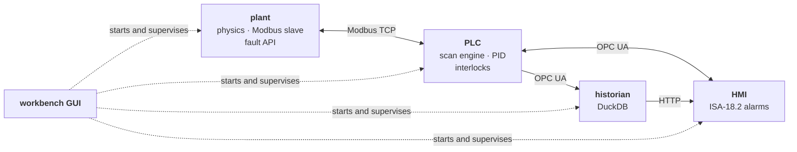

Four processes speaking the protocols a real plant uses. Every signal is
declared once, in `pyplant/tags.py`, with its units, span, scale factor,
address, owner and alarm limits; everything else imports it from there.

<details>
<summary><b>Ports</b> (workspace base port 5400)</summary>

| port | service | protocol | open in a browser? |
| --- | --- | --- | --- |
| 5400 | plant | Modbus TCP | no |
| 5401 | plant | HTTP, fault API | yes, at `/docs` |
| 5402 | PLC | Modbus TCP | no |
| 5403 | PLC | OPC UA | no; use an OPC UA client |
| 5404 | historian | HTTP, query API | yes, at `/api/health` |
| 5405 | HMI | HTTP, operator page | yes |
| 8050 | workbench | HTTP | yes |
</details>

### Fault detection

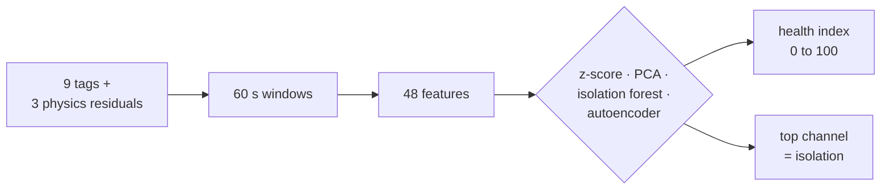

Trained on normal operation only, judged on runs it has never seen. Methods,
hyperparameters and evaluation: [DETECTION.md](docs/DETECTION.md).

<details>
<summary><b>Inside each layer</b></summary>

| layer | what it does |
| --- | --- |
| **Physics** | Two tanks, a pump with a quadratic curve, an equal-percentage valve with actuator lag. The pump/valve algebraic loop is solved in closed form, so there is no iteration and no stiffness. |
| **Controller** | Velocity-form PID with derivative on measurement, structural anti-windup, bumpless auto/manual transfer, initialised from valve feedback. |
| **PLC** | A scan engine with drift-free scheduling that reports its own scan time and overruns as tags. Hysteresis on alarms, an on-delay minimum-flow trip, latching interlocks. |
| **Field network** | Modbus TCP between the plant and the PLC, block reads only, every value through one codec. |
| **SCADA** | An OPC UA address space generated from the tag dictionary, with engineering units and ranges on every node. |
| **Historian** | DuckDB, stored by exception, queried with last-value-carried-forward resampling so a held signal is never interpolated into a ramp. |
| **Alarms** | The ISA-18.2 state machine, including the state a boolean cannot express: an alarm that cleared before anyone saw it stays visible until acknowledged. Priorities and expiring shelves. |
| **Faults** | Leaks, fouling, pump wear, valve stiction, and sensor bias, drift, freezing and noise, each with a ramp. |
| **Detection** | Four methods compared on held-out runs, with physics-informed residual channels for isolation. |
| **Workbench** | One Dash GUI that starts and supervises the four services, injects faults, generates datasets and trains detectors in the background. |
</details>

## Results

58 one-hour scenarios: 10 normal runs and seven fault modes, each at three
magnitudes with randomised onset and its own seed. Detectors are fitted on
normal runs only and judged on runs they have never seen, split by run so
overlapping windows cannot leak between training and test.

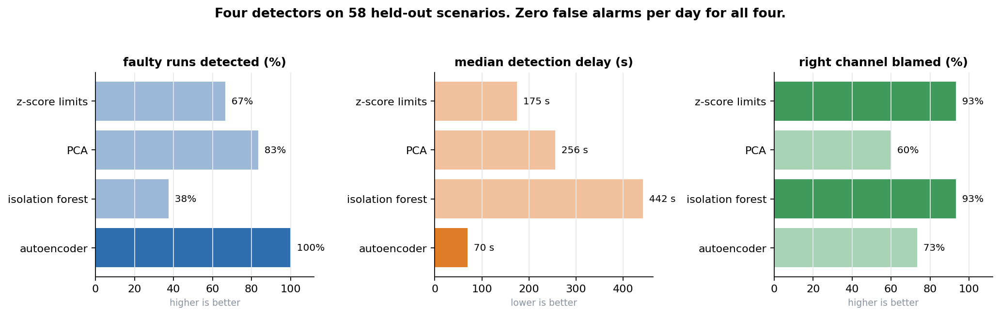

| method | faulty runs detected | median delay | false alarms | isolation |
| --- | --- | --- | --- | --- |
| z-score limits | 66.7 % | 175 s | 0 per day | 93 % |
| PCA (classical MSPC) | 83.3 % | 256 s | 0 per day | 60 % |
| isolation forest | 37.5 % | 442 s | 0 per day | 93 % |
| **autoencoder** | **100 %** | **70 s** | **0 per day** | 73 % |

**The autoencoder catches every fault, and fastest.** It is the only method of
the four that does. That is consistent with the plant being non-linear,
square-root drains, a quadratic pump curve, an equal-percentage valve, which a
linear subspace like PCA's cannot follow; these runs show the gap, not its
cause.

**But the best detector is not the best isolator.** Z-score limits and the
isolation forest name the right channel far more often while missing most
faults outright:

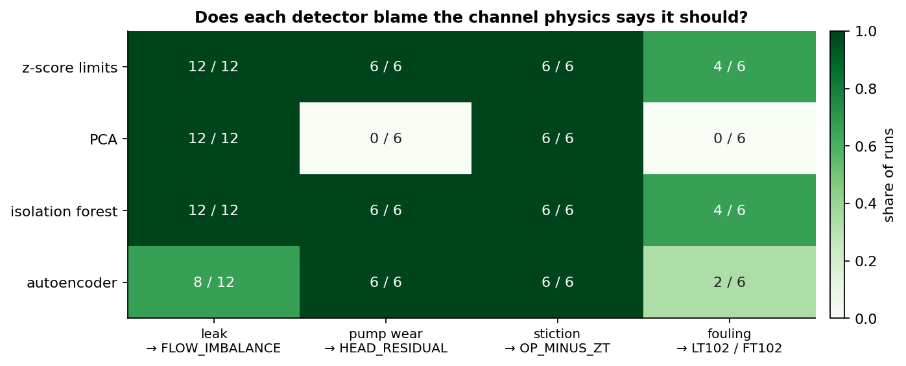

Choosing a detector is a trade-off, not a ranking. Isolation, sensor faults
and how to reproduce these numbers are in
[DETECTION.md](docs/DETECTION.md#results).

## Deployment

| way | command | then open |
| --- | --- | --- |
| **Workbench** | `pyplant-workbench` | <http://127.0.0.1:8050> |
| **Services by hand** | `python examples/run_stack.py` | HMI <http://127.0.0.1:5405>, fault API <http://127.0.0.1:5401/docs> |
| **Docker, one container** | `docker compose up --build` | <http://localhost:8050> |
| **Docker, four containers** | `docker compose --profile services up --build plant plc historian hmi` | HMI <http://localhost:8080>, fault API <http://localhost:8000/docs> |

<details>
<summary><b>More on each</b></summary>

**Workbench.** `pyplant-workbench --workspace ./work/demo --base-port 5400`.
The workspace directory holds the config, datasets, trained models and
history. `--host 0.0.0.0` exposes the GUI past localhost. Two people on one
machine each need their own workspace, base port and GUI port.

**Services by hand.** The same four processes, started in order, because each
one connects to the one before. `python examples/inject_fault.py` then injects
a leak and prints the controller's response once a second.

**Docker, one container.** The workbench runs inside the container and
supervises the four services there. Only the GUI port is published. Datasets
and trained models stay in the `workbench-data` volume across restarts. The
container runs as an unprivileged user and health-checks the GUI.

**Docker, four containers.** Each service in its own container on a private
network, reached by name: a field device, a controller, a historian and an
operator station. There is no workbench in this mode; the HMI is the
interface, and OPC UA is published on `opc.tcp://localhost:4840/pyplant/`. If
the PLC starts before the plant is listening, it exits and is restarted, which
is what a controller does when its field device is late.

Every flag, the workspace `config.json`, platform notes and troubleshooting:
[DEPLOYMENT.md](docs/DEPLOYMENT.md).
</details>

## Documentation

| | |
| --- | --- |
| [Tutorial](docs/TUTORIAL.md) | one leak, cold start to trained detector, screenshot at every step |
| [Quick-start guide](docs/pdf/pyplant-quickguide.pdf) | 20-page PDF |
| [User manual](docs/pdf/pyplant-manual.pdf) | 88-page PDF, the full reference |
| [Poster](docs/pdf/pyplant-poster.pdf) | the project on one page |
| [CONTROL.md](docs/CONTROL.md) | the plant model, the PID, IMC tuning |
| [DETECTION.md](docs/DETECTION.md) | the four detectors, evaluation, results |
| [ARCHITECTURE.md](docs/ARCHITECTURE.md) | processes, protocols, design rules, extending |
| [DEPLOYMENT.md](docs/DEPLOYMENT.md) | installing, running, Docker, troubleshooting |
| [DESIGN_NOTES.md](docs/DESIGN_NOTES.md) | how it was built, and the bugs measurement found |

The design notes are the most interesting read. A PID that slammed the valve
shut on its first scan, a PLC timer that never fired because ten times 0.1 is
not 1.0, a stiction model that produced no limit cycle until the plant was
given instrument noise, a detector judged against the wrong instrument: each
was found by measuring something, and each changed the design.

## Project layout

<details>
<summary>Show the tree</summary>

```
pyplant/
├── pyplant/            the package
│   ├── tags.py         every signal, declared once
│   ├── core/           plant physics
│   ├── plc/            PID, PLC program, scan engine
│   ├── net/            Modbus and OPC UA
│   ├── hist/           historian
│   ├── hmi/            alarms and the operator API
│   ├── faults/         fault models and scenarios
│   ├── ml/             features, detectors, evaluation
│   ├── services/       the four process entry points
│   └── workbench/      the GUI, supervisor and job runner
├── tests/              372 tests
├── docs/               tutorial, control, detection, architecture,
│   │                   deployment, design notes
│   ├── images/         figures, regenerated by make_figures.py
│   ├── manual/         LaTeX sources for the manual and poster
│   └── pdf/            the built manual, quick guide and poster
├── examples/           run the stack, inject a fault, from code
├── Dockerfile
└── docker-compose.yml
```
</details>

## Testing

```bash
pytest -m "not slow"     # unit tests, about two minutes
pytest -m slow           # integration: real processes on real ports
```

The integration tests start the four services as subprocesses and drive them
over Modbus, OPC UA and HTTP. Continuous integration runs the unit tests on
Python 3.11 and 3.12, the integration tests on 3.12, and builds and smoke-tests
the Docker image.

The figures in this README are drawn from real runs of the code. After
changing the plant or retraining, redraw them:

```bash
python docs/make_figures.py --artifacts work/demo/artifacts
```

## Roadmap

- **Live inference.** The `HEALTH_INDEX`, `TOP_CONTRIB` and `ALM_HEALTH` tags
  are declared and the HMI is ready to show them, but nothing publishes them
  yet. The next step is a service that runs the trained detector on a rolling
  window from the historian and writes its verdict back over OPC UA, so a
  diagnosis becomes an alarm.
- **A second plant.** The physics sits behind one interface; a jacketed CSTR or
  the Tennessee Eastman process would exercise the same stack on a harder
  problem.

## FAQ

<details>
<summary><b>A port shows nothing in my browser.</b></summary>

Only the HTTP ports serve pages. The Modbus and OPC UA ports speak binary
protocols, so a browser gets no response. See the [ports table](#the-system).
</details>

<details>
<summary><b>Opening <code>/api/fault</code> says "Method Not Allowed".</b></summary>

That endpoint takes POST, and a browser address bar sends GET. Use the Faults
tab, the form at `/docs`, or `examples/inject_fault.py`.
</details>

<details>
<summary><b>The sticking-valve or frozen-sensor fault does nothing.</b></summary>

Both need the loop to move. Raise the speed for stiction. For a frozen
transmitter, change the setpoint after injecting it.
</details>

<details>
<summary><b>Why is <code>pymodbus</code> pinned below 3.9?</b></summary>

Later versions replaced the datastore API the plant uses to update its
registers while serving them.
</details>

<details>
<summary><b>Can I <code>pip install pyplant</code>?</b></summary>

No. An unrelated package with that name exists on PyPI. Install from this
repository.
</details>

<details>
<summary><b>Something else went wrong.</b></summary>

[Troubleshooting](docs/DEPLOYMENT.md#troubleshooting) covers every problem
found while setting this up on Linux and Windows, from the wrong conda
environment to PowerShell execution policy.
</details>

## Citation

If this is useful in your work, citation details are in
[CITATION.cff](CITATION.cff); GitHub shows a *Cite this repository* button for
it.

## License

[MIT](LICENSE) © Mohammadhossein Modirrousta
