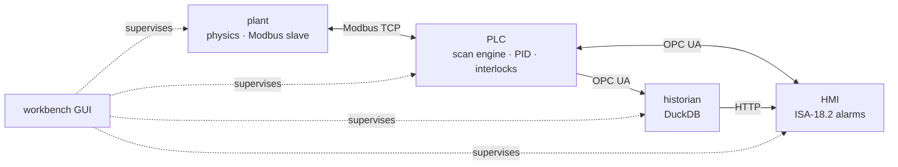

# pyplant

**A process plant you can break on purpose.** A simulated two-tank plant with a
soft PLC, a Modbus and OPC UA SCADA stack, a historian, ISA-18.2 alarm
management, fault injection, and machine-learning fault detection, all driven
from one GUI.

[](https://github.com/mhmodir/pyplant/actions/workflows/ci.yml)


Everything a real plant has is here, at bench scale: a centrifugal pump feeding
a tank through a control valve, a second tank downstream, a PID loop holding
level, interlocks that trip the pump, and the network between the field, the
controller and the operator. All of it runs in Python on a laptop, at real time
or up to twenty times faster.

## The fault you cannot see

Open a leak in tank 1 under a working level controller:

| | tank level | controller output |
| --- | --- | --- |
| before the leak | 300.00 mm | 66.18 % |
| after it settles | **300.00 mm** | **75.80 %** |

The level returns to setpoint exactly. The controller has absorbed the fault,
and its entire signature now lives in the valve position. A detector that
watches only the process value cannot see this fault at all, which is why every
detector here is fed the controller output alongside the measurements. That is
the problem this project is built to study: in a closed loop, the controller
hides the fault you are looking for.

## What is in it

| layer | what it does |
| --- | --- |
| **Physics** | Two tanks, a pump with a quadratic curve, an equal-percentage valve with actuator lag. The pump/valve algebraic loop is solved in closed form, so there is no iteration and no stiffness. |
| **Controller** | Velocity-form PID with derivative on measurement, structural anti-windup, bumpless auto/manual transfer, initialised from valve feedback. |
| **PLC** | A scan engine with drift-free scheduling that reports its own scan time and overruns as tags. Hysteresis on alarms, an on-delay minimum-flow trip, latching interlocks. |
| **Field network** | Modbus TCP between the plant and the PLC, block reads only, every value through one codec. |
| **SCADA** | An OPC UA address space generated from the tag dictionary, with engineering units and ranges on every node. |
| **Historian** | DuckDB, stored by exception, queried with last-value-carried-forward resampling so a held signal is never interpolated into a ramp. |
| **Alarms** | The ISA-18.2 state machine, including the state a boolean cannot express: an alarm that cleared before anyone saw it stays visible until acknowledged. Priorities and expiring shelves. |
| **Faults** | Leaks, fouling, pump wear, valve stiction, and sensor bias, drift, freezing and noise, each with a ramp. Injected into the live plant through an API the control system cannot see. |
| **Detection** | Four methods compared on held-out runs: z-score limits, PCA, isolation forest and an autoencoder, with physics-informed residual channels for isolation. |
| **Workbench** | One Dash GUI that starts and supervises the four services, injects faults, generates datasets and trains detectors in the background. |

## Quick start

Python 3.11 or newer.

```bash
git clone https://github.com/mhmodir/pyplant.git
cd pyplant
python -m pip install -e ".[ml,ui,dev]"
pyplant-workbench
```

Open <http://127.0.0.1:8050>.

1. **Quick start tab.** Runs a leak scenario offline in a few seconds, with
   nothing else running.
2. **Start stack.** Launches the plant, the PLC, the historian and the HMI.
3. **Faults tab.** Click *Leak in tank 1*, then watch the Runtime tab.
4. **Data tab, then Model tab.** Generate a labelled dataset and train the
   detectors.


## Deployment

Four ways to run it, from one command to something shaped like a plant.
[DEPLOYMENT.md](docs/DEPLOYMENT.md) has every flag, the workspace
`config.json`, platform notes and troubleshooting.

**Workbench.** The usual way. After the install above:

```bash
pyplant-workbench --workspace ./work/demo --base-port 5400
```

Open <http://127.0.0.1:8050>. **Start stack** launches the plant, the PLC, the
historian and the HMI as separate processes and drives them over HTTP. The
workspace directory holds the config, datasets, trained models and history.
`--host 0.0.0.0` exposes the GUI past localhost. Two people on one machine
each need their own workspace, base port and GUI port.

**Services by hand.** The same four processes, started in order, because each
one connects to the one before. `python examples/run_stack.py` starts all of
them. The operator page is then at <http://127.0.0.1:5405>, and the fault API,
with a form for every endpoint, at <http://127.0.0.1:5401/docs>.

**Docker, one container.** Nothing installed except Docker:

```bash
docker compose up --build
```

Open <http://localhost:8050>. The workbench runs inside the container and
supervises the four services there. Only the GUI port is published. Datasets
and trained models stay in the `workbench-data` volume across restarts. The
container runs as an unprivileged user and health-checks the GUI.

**Docker, four containers.** Each service in its own container, on a private
network, reached by name — a field device, a controller, a historian and an
operator station:

```bash
docker compose --profile services up --build plant plc historian hmi
```

There is no workbench in this mode. The HMI is the interface.

| URL | what |
| --- | --- |
| <http://localhost:8080> | operator HMI |
| <http://localhost:8000/docs> | fault injection API |
| `opc.tcp://localhost:4840/pyplant/` | OPC UA, for a client such as UaExpert |

If the PLC starts before the plant is listening, it exits and is restarted,
which is what a controller does when its field device is late.

## Results

58 one-hour scenarios: 10 normal runs and seven fault modes, each at three
magnitudes with randomised onset and its own seed. Detectors are fitted on
normal runs only and judged on runs they have never seen, split by run rather
than by sample so overlapping windows cannot leak between training and test.

| method | faulty runs detected | median detection delay | false alarms | isolation |
| --- | --- | --- | --- | --- |
| z-score limits | 66.7 % | 175 s | 0 per day | 93 % |
| PCA (classical MSPC) | 83.3 % | 256 s | 0 per day | 60 % |
| isolation forest | 37.5 % | 442 s | 0 per day | 93 % |
| **autoencoder** | **100 %** | **70 s** | **0 per day** | 73 % |

A detection needs three consecutive flagged windows, and false alarms are
counted the same way, so both columns describe the same detector. Isolation is
scored against the channel that physics names for each fault.

Two things stand out. The autoencoder is the only method that catches every
fault, and it catches them fastest. But **the best detector is not the best
isolator**: z-score limits and the isolation forest name the right channel far
more often while missing most faults outright. Choosing one is a trade-off,
not a ranking.

### Physics does the isolation

Three channels are computed rather than measured, each from a physical law that
a fault breaks:

| channel | the argument |
| --- | --- |
| `FLOW_IMBALANCE` | inflow minus outflow is zero by conservation of mass |
| `HEAD_RESIDUAL` | pump pressure minus what the pump curve predicts at that flow |
| `OP_MINUS_ZT` | valve command minus measured stem position, zero on a healthy valve |

How often each method names the right one, run by run on the held-out set:

| fault, and the channel physics names | z-score | PCA | isolation forest | autoencoder |
| --- | --- | --- | --- | --- |
| leak → `FLOW_IMBALANCE` | 12 / 12 | 12 / 12 | 12 / 12 | 8 / 12 |
| pump wear → `HEAD_RESIDUAL` | 6 / 6 | 0 / 6 | 6 / 6 | 6 / 6 |
| stiction → `OP_MINUS_ZT` | 6 / 6 | 6 / 6 | 6 / 6 | 6 / 6 |

Every method finds stiction through the command-to-stem gap. PCA never
attributes pump wear to the pump curve, and the autoencoder, the strongest
detector, is the weakest at pinning leaks on the mass balance.

A sticking valve makes the controller and the valve fight. On the live plant,
the command-to-stem gap rises from 0.14 % to 6.00 % while the level barely
moves 1.5 mm. The measurement shows almost nothing; the residual shows
everything.

Sensor faults are the hard case and are reported separately. In a closed loop a
level transmitter reading 25 mm high is driven back to setpoint by the
controller, so its reading looks perfect and the signature appears everywhere
except the faulty instrument.

Reproduce these numbers from the workbench's Data and Model tabs with the
default settings.

## Architecture



Four processes speaking the protocols a real plant uses, supervised by the GUI.
Every signal is declared once, in `pyplant/tags.py`, with its units, span,
scale factor, address, owner and alarm limits; every other module imports it
from there. [ARCHITECTURE.md](docs/ARCHITECTURE.md) has the data paths, the
design rules and how to extend each layer.

## Documentation

| | |
| --- | --- |
| [Quick-start guide](docs/pdf/pyplant-quickguide.pdf) | 20 pages, install to trained detector |
| [User manual](docs/pdf/pyplant-manual.pdf) | 88 pages, the full reference |
| [Poster](docs/pdf/pyplant-poster.pdf) | the project on one page |
| [ARCHITECTURE.md](docs/ARCHITECTURE.md) | processes, protocols, design rules, extending |
| [DEPLOYMENT.md](docs/DEPLOYMENT.md) | installing, running, Docker, troubleshooting |
| [DESIGN_NOTES.md](docs/DESIGN_NOTES.md) | how it was built, and the bugs measurement found |

The design notes are the most interesting read. A PID that slammed the valve
shut on its first scan, a PLC timer that never fired because ten times 0.1 is
not 1.0, a stiction model that produced no limit cycle until the plant was
given instrument noise, a detector judged against the wrong instrument: each
was found by measuring something, and each changed the design.

## Project layout

```
pyplant/
├── pyplant/            the package
│   ├── tags.py         every signal, declared once
│   ├── core/           plant physics
│   ├── plc/            PID, PLC program, scan engine
│   ├── net/            Modbus and OPC UA
│   ├── hist/           historian
│   ├── hmi/            alarms and the operator API
│   ├── faults/         fault models and scenarios
│   ├── ml/             features, detectors, evaluation
│   ├── services/       the four process entry points
│   └── workbench/      the GUI, supervisor and job runner
├── tests/              372 tests
├── docs/               architecture, deployment, design notes, manual
├── examples/           scripts for running the stack and injecting faults
├── Dockerfile
└── docker-compose.yml
```

## Testing

```bash
pytest -m "not slow"     # unit tests, about two minutes
pytest -m slow           # integration: real processes on real ports
```

The integration tests start the four services as subprocesses and drive them
over Modbus, OPC UA and HTTP. Continuous integration runs the unit tests on
Python 3.11 and 3.12, the integration tests on 3.12, and builds and smoke-tests
the Docker image.

## Roadmap

- **Live inference.** The `HEALTH_INDEX`, `TOP_CONTRIB` and `ALM_HEALTH` tags
  are declared and the HMI is ready to show them, but nothing publishes them
  yet. The next step is a service that runs the trained detector on a rolling
  window from the historian and writes its verdict back over OPC UA, so a
  diagnosis becomes an alarm.
- **A second plant.** The physics sits behind one interface; a jacketed CSTR or
  the Tennessee Eastman process would exercise the same stack on a harder
  problem.

## Notes

- `pymodbus` is pinned below 3.9. Later versions replaced the datastore API
  that the plant uses to update its registers while serving them.
- On Windows keep the speed at 4x or below. Above that the scan period falls
  under the 15.6 ms timer resolution and the PLC, correctly, reports overruns.
- An unrelated package called `pyplant` exists on PyPI. Install from this
  repository, not with `pip install pyplant`.

## Citation

If this is useful in your work, citation details are in
[CITATION.cff](CITATION.cff); GitHub shows a *Cite this repository* button for
it.

## License

[MIT](LICENSE) © Mohammadhossein Modirrousta
