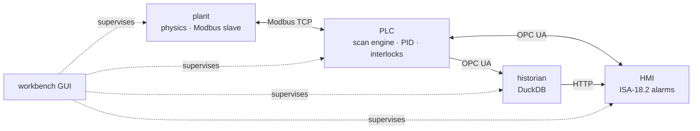

# pyplant

**A process plant you can break on purpose.** A simulated two-tank plant with a
soft PLC, a Modbus and OPC UA SCADA stack, a historian, ISA-18.2 alarm
management, fault injection, and machine-learning fault detection, all driven
from one GUI.

[](https://github.com/mhmodir/pyplant/actions/workflows/ci.yml)


Everything a real plant has is here, at bench scale: a centrifugal pump feeding
a tank through a control valve, a second tank downstream, a PID loop holding
level, interlocks that trip the pump, and the network between the field, the
controller and the operator. All of it runs in Python on a laptop, at real time
or up to twenty times faster.

## The fault you cannot see

Open a leak in tank 1 under a working level controller:

| | tank level | controller output |
| --- | --- | --- |
| before the leak | 300.00 mm | 66.18 % |
| after it settles | **300.00 mm** | **75.80 %** |

The level returns to setpoint exactly. The controller has absorbed the fault,
and its entire signature now lives in the valve position. A detector that
watches only the process value cannot see this fault at all, which is why every
detector here is fed the controller output alongside the measurements. That is
the problem this project is built to study: in a closed loop, the controller
hides the fault you are looking for.

## What is in it

| layer | what it does |
| --- | --- |
| **Physics** | Two tanks, a pump with a quadratic curve, an equal-percentage valve with actuator lag. The pump/valve algebraic loop is solved in closed form, so there is no iteration and no stiffness. |
| **Controller** | Velocity-form PID with derivative on measurement, structural anti-windup, bumpless auto/manual transfer, initialised from valve feedback. |
| **PLC** | A scan engine with drift-free scheduling that reports its own scan time and overruns as tags. Hysteresis on alarms, an on-delay minimum-flow trip, latching interlocks. |
| **Field network** | Modbus TCP between the plant and the PLC, block reads only, every value through one codec. |
| **SCADA** | An OPC UA address space generated from the tag dictionary, with engineering units and ranges on every node. |
| **Historian** | DuckDB, stored by exception, queried with last-value-carried-forward resampling so a held signal is never interpolated into a ramp. |
| **Alarms** | The ISA-18.2 state machine, including the state a boolean cannot express: an alarm that cleared before anyone saw it stays visible until acknowledged. Priorities and expiring shelves. |
| **Faults** | Leaks, fouling, pump wear, valve stiction, and sensor bias, drift, freezing and noise, each with a ramp. Injected into the live plant through an API the control system cannot see. |
| **Detection** | Four methods compared on held-out runs: z-score limits, PCA, isolation forest and an autoencoder, with physics-informed residual channels for isolation. |
| **Workbench** | One Dash GUI that starts and supervises the four services, injects faults, generates datasets and trains detectors in the background. |

## Quick start

Python 3.11 or newer.

```bash
git clone https://github.com/mhmodir/pyplant.git
cd pyplant
python -m pip install -e ".[ml,ui,dev]"
pyplant-workbench
```

Open <http://127.0.0.1:8050>.

1. **Quick start tab.** Runs a leak scenario offline in a few seconds, with
   nothing else running.
2. **Start stack.** Launches the plant, the PLC, the historian and the HMI.
3. **Faults tab.** Click *Leak in tank 1*, then watch the Runtime tab.
4. **Data tab, then Model tab.** Generate a labelled dataset and train the
   detectors.


## Deployment

Four ways to run it, from one command to something shaped like a plant.
[DEPLOYMENT.md](docs/DEPLOYMENT.md) has every flag, the workspace
`config.json`, platform notes and troubleshooting.

**Workbench.** The usual way. After the install above:

```bash
pyplant-workbench --workspace ./work/demo --base-port 5400
```

Open <http://127.0.0.1:8050>. **Start stack** launches the plant, the PLC, the
historian and the HMI as separate processes and drives them over HTTP. The
workspace directory holds the config, datasets, trained models and history.
`--host 0.0.0.0` exposes the GUI past localhost. Two people on one machine
each need their own workspace, base port and GUI port.

**Services by hand.** The same four processes, started in order, because each
one connects to the one before. `python examples/run_stack.py` starts all of
them. The operator page is then at <http://127.0.0.1:5405>, and the fault API,
with a form for every endpoint, at <http://127.0.0.1:5401/docs>.

**Docker, one container.** Nothing installed except Docker:

```bash
docker compose up --build
```

Open <http://localhost:8050>. The workbench runs inside the container and
supervises the four services there. Only the GUI port is published. Datasets
and trained models stay in the `workbench-data` volume across restarts. The
container runs as an unprivileged user and health-checks the GUI.

**Docker, four containers.** Each service in its own container, on a private
network, reached by name — a field device, a controller, a historian and an
operator station:

```bash
docker compose --profile services up --build plant plc historian hmi
```

There is no workbench in this mode. The HMI is the interface.

| URL | what |
| --- | --- |
| <http://localhost:8080> | operator HMI |
| <http://localhost:8000/docs> | fault injection API |
| `opc.tcp://localhost:4840/pyplant/` | OPC UA, for a client such as UaExpert |

If the PLC starts before the plant is listening, it exits and is restarted,
which is what a controller does when its field device is late.

## One leak, from a cold start to a trained detector

This is the walkthrough in the manual, on workspace `work/manual` at 1×.
Unit 1 is in automatic at 300 mm. The operator raises the setpoint to 340 mm,
then a hole of effective area `5e-5` m² opens in tank 1. The level comes back.
The valve does not.

```bash
python -m pyplant.workbench.app --workspace ./work/manual
```

Open <http://127.0.0.1:8050>.

1. **Run it offline first.** On Quick start, leave the scenario on *Leak in
   tank 1*, length 30 minutes, and press **Run scenario**. Nothing else has
   to be running. The level ends where it started (`LT101` changes by about
   +0.02 mm). The controller output rises about 9.6 points, and the inflow
   rises by the leak flow, about 2.9 L/min. Onset is at 720 s. At that
   instant the level dips about 20 mm and recovers; the valve stays further
   open for as long as the leak lasts.
2. **Start the live stack.** On Runtime, keep speed at 1× and press **Start
   stack**. The header goes green at 4/4. Healthy steady state is about
   `LT101` 300.0 mm, `LT102` 176.8 mm, `FCV101` 66%, inflow and outflow both
   near 10 L/min, pump discharge near 50 kPa, and a scan of a few
   milliseconds inside a 100 ms budget.
3. **Step the setpoint.** On the LIC101 faceplate write 340 and press
   **Write**. The output kicks toward 80%, the level reaches 340 mm in about
   a minute with no overshoot, and the output settles near 69%. A fuller
   tank drains faster, so holding it takes a slightly more open valve.
4. **Inject the leak.** On Faults, press *Leak in tank 1*. The ground-truth
   table should show reported and true values within the noise: the hole is
   in the process, so no transmitter is lying. About two minutes later the
   valve is near 93% and the level is climbing back. Inflow is up around
   18 L/min and pump pressure has fallen, because the pump is further out on
   its curve. Open the HMI at <http://127.0.0.1:5405>. The alarm list stays
   empty. The level never crossed a limit.
5. **Train something that can see it.** Clear the fault. On Data, press
   **Quick** and **Generate**. The live plant keeps running; the dataset is
   built by the fast runner in another process. On Model, train all four
   detectors. A detection is three flagged windows in a row. Compare
   detection rate, delay and which channel each method blames.

Press **Stop** when you are done. The same path with the Standard preset
(one-hour runs, three magnitudes, the repeats in the results below) is what
the numbers in this file come from.

## Control

LIC101 holds the level in tank 1. It reads the process value `LT101`,
subtracts it from the setpoint, and moves the valve command `FCV101_OP`. The
loop is reverse-acting: when the level falls, the output rises. The code is
`pyplant/plc/pid.py`. The plant it acts on is `pyplant/core/hybrid_tank.py`.

### What the controller is pushing against

Two vertical tanks. Volume balances, with a leak only on tank 1:

$$
A_1 \frac{dh_1}{dt} = q_\mathrm{in} - q_{12} - q_\mathrm{leak},
\qquad
A_2 \frac{dh_2}{dt} = q_{12} - q_\mathrm{out}.
$$

Each gravity drain follows Torricelli, $q = C_d A \sqrt{2gh}$. The
interconnect can foul ($C_d A_{12}$ shrinks) and the leak is an extra orifice
on tank 1. The centrifugal pump is a quadratic curve, shut-off 60 kPa and
run-out 25 L/min, and wear scales the whole curve down. The valve is
equal-percentage with rangeability 30, so equal steps of the stem change the
flow by equal percentages, and under the falling pump curve the installed
characteristic is roughly linear. Pump pressure depends on flow and flow
depends on pump pressure; substituting and solving the quadratic gives
$q_\mathrm{in}$ in closed form, so a 50 ms integration step needs no
iteration and the model is not stiff.

Around the design point the tank behaves as a first-order lag,

$$
G(s) = \frac{K}{\tau s + 1}, \qquad K = 15.4\ \mathrm{mm}/\%, \quad \tau = 72\ \mathrm{s}.
$$

The open-loop time constant is why a slow fault takes minutes to show at 1×
and about a tenth of that at 10×.

### The PID, in velocity form

The continuous law, in ISA standard form, is

$$
u(t) = K_c \left( e(t) + \frac{1}{T_i}\int_0^t e(\tau)\,d\tau + T_d \frac{de}{dt} \right),
\qquad e = \mathrm{SP} - \mathrm{PV}.
$$

Proportional reacts to the error now, and alone it leaves an offset whenever
a non-zero valve opening is required to hold the level. Integral keeps moving
the valve until that error is exactly zero. Derivative anticipates; on a
noisy level it hurts, so LIC101 runs with $T_d = 0$.

The code does not store an integral. It stores the output, and each scan adds
an increment. With backward differences, sample time $T_s$, and the derivative
taken on a filtered measurement $y^f$ rather than on the error:

$$
\Delta u_k = K_c(e_k - e_{k-1}) + K_c\frac{T_s}{T_i} e_k
- K_c\frac{T_d}{T_s}\big(y^f_k - 2y^f_{k-1} + y^f_{k-2}\big),
$$

$$
u_k = \mathrm{clip}(u_{k-1} + \Delta u_k,\ 0,\ 100).
$$

Two properties that need extra logic in the positional form fall out of this
one. When the valve hits 0% or 100%, the increment that would have gone past
the stop is thrown away, so nothing keeps integrating behind the limit and
the output leaves the stop on the first scan the error changes sign.
In manual, the output is whatever the operator wrote and the error history
is kept current; returning to auto continues from that value, so the stem
does not jump. Differentiating the measurement, after a 5 s low-pass,
avoids the kick a setpoint step would otherwise put through the derivative.
The first scan copies the measured stem `ZT101` into the output. Starting
from 0% on a plant sitting at 66% would shut the valve, dead-head the pump
and trip the low-flow interlock immediately.

### IMC tuning

Internal model control picks the gains so the closed loop behaves like a
first-order lag of time constant $\lambda$, chosen by the engineer. For
$G(s)$ above, that controller is a PI:

$$
K_c = \frac{\tau}{K\lambda}, \qquad T_i = \tau,
\qquad
\frac{\mathrm{PV}(s)}{\mathrm{SP}(s)} = \frac{1}{\lambda s + 1}.
$$

With $\lambda = 13$ s the loop is about 5.5 times faster than the open plant,
which leaves margin for the valve lag, the sample time and the nonlinearity
the first-order model leaves out:

| | value | role |
| --- | --- | --- |
| $K_c$ | 0.35 %/mm | controller gain |
| $T_i$ | 72 s | integral time. 0 turns integral off |
| $T_d$ | 0 | derivative time. 0 turns derivative off |
| $T_f$ | 5 s | filter on the measurement before the derivative |
| $T_s$ | 0.1 s | PLC scan. The output is held between scans |

A 50 mm setpoint step on this tuning settles to 2% in about 40–50 s, with no
overshoot and no offset. The measured loop matches that.

The PLC holds its output for the whole scan, a zero-order hold, which is
about $T_s/2 = 50$ ms of dead time. That is nothing next to $\lambda = 13$ s.
The simulator still integrates at 50 ms with the input held, because a PID
that was only ever stepped in continuous time usually looks better in
simulation than it does on a scan.

### Why the level comes back

A leak is a load disturbance. A PI controller has a pole at $s = 0$, so the
final-value theorem gives zero steady-state error to a step disturbance. The
level returns to the setpoint exactly. The valve opening is the record of
how much extra flow the loop had to supply. A detector that watches only
`LT101` is looking at the one signal the controller has been paid to keep
still. That is why every detector below is given the controller output, the
stem position and the three physics residuals.

## Fault detection

Training never sees a fault. A plant has a long record of ordinary operation
and very few labelled failures, so a classifier trained on faults would be
learning the rarest thing it will meet, and it would miss a mode nobody has
named yet. Each detector learns normal operation and scores how far a new
window is from it. Fault runs are used only afterwards, to measure the score.
The implementation is `pyplant/ml`.

A window is 60 samples at 1 Hz, one minute, stepped forward by 10 samples. It
is labelled by its last sample, so a window that merely contains the onset is
still called normal and the detection delay cannot come out negative. One
sample cannot show a drift, a shift or a limit cycle; the window can.

Twelve channels go in. Nine are tags: `LT101`, `LT102`, `FT101`, `FT102`,
`PT101`, `ZT101`, `FCV101_OP`, `LIC101_SP`, `LIC101_ERR`. Three are computed
from a balance the fault breaks: `FLOW_IMBALANCE`, `HEAD_RESIDUAL` and
`OP_MINUS_ZT`, as in the table under Results. Each channel becomes four
numbers over the window, last value, mean, standard deviation and
least-squares slope, so a window is 48 features named `CHANNEL::stat`. Every
detector then standardises with the mean and standard deviation of the normal
training runs. Thresholds are the 0.995 quantile of the score on held-out
normal runs, never on the data the model was fit to. A window is flagged
when its score exceeds that threshold. The health index pins the threshold
at 50 and gives one decade of score per 50 points,

$$
\mathrm{HI} = \mathrm{clip}\!\left(50\log_{10}\frac{a}{\theta} + 50,\ 0,\ 100\right),
$$

so an alarm limit on `HEALTH_INDEX` means the same thing after a retrain.
Contributions sum the squared residual by channel; the top channel is the
isolation result. The isolation forest has no reconstruction, so its
contributions fall back to the squared standardised features.

### Z-score limits

No model. In standardised units the normal mean is zero, and the score is the
squared distance from it, $a = \sum_j z_j^2$. If the 48 features were
independent Gaussians this would be $\chi^2$ with 48 degrees of freedom and a
fixed limit would set a known false-alarm rate. They are not independent
(`LT101` and `LIC101_ERR` are almost the same signal), so the limit is the
calibration quantile. This is the baseline the other three have to beat.

### PCA

Classical multivariate statistical process control. Normal operation, tied
together by a few physical relationships, lies near a low-dimensional
subspace. A fault that breaks a relationship leaves that subspace even when
every single tag is still inside its own normal range.

The covariance of the standardised training windows is diagonalised and the
smallest set of components that keeps 95% of the variance is kept. A window
is projected onto that subspace and back. The score is the squared prediction
error, the distance off the subspace, $\lVert z - \hat z \rVert^2$. The faults
here break a correlation, so that off-subspace distance is the statistic that
sees them. The per-feature residual $z - \hat z$ is what the contribution
plot sums.

### Isolation forest

Anomalies are few and different, so a random split isolates them sooner than
it isolates a normal point. Two hundred trees are each grown on a random
subsample by picking a random feature and a random cut between its min and
max, until every point sits alone. The score is the average path length,
normalised by the expected depth of a binary search tree and mapped into
$(0, 1]$:

$$
a(x) = 2^{-\mathbb{E}[h(x)] / c(\psi)}.
$$

Values near 1 are anomalies. The code stores the negated scikit-learn
`score_samples`, which is this quantity, so larger is still worse and the
same threshold and health index apply. Isolation uses $z_j^2$, the same
per-feature residual as the z-score detector.

### Autoencoder

PCA is the best *linear* subspace. This plant is not linear: Torricelli
drains go as $\sqrt{h}$, the pump curve is quadratic, and the valve is
equal-percentage. The autoencoder learns a non-linear manifold with the same
score and the same contributions. A linear autoencoder trained on squared
error would recover the principal subspace, so PCA is the special case, and
the network only earns its place if the non-linearity detects faults PCA
misses. Both are always trained, and the comparison is kept.

The network is a multilayer perceptron, 48–32–8–32–48. Hidden units use
$\tanh$, which is smooth and zero-centred on standardised inputs. The output
layer is linear, because those inputs are unbounded. The encoder squeezes 48
numbers through a bottleneck of 8; the decoder tries to rebuild them. Trained
only on normal windows, it can rebuild what looks like normal operation and
fails on the rest. The score is the squared reconstruction error,
$\lVert z - f_\Theta(z) \rVert^2$.

Training minimises mean squared error plus a small L2 penalty on the weights
($\alpha = 10^{-4}$). Gradients come from backpropagation. Adam keeps a
running average of the gradient and of its square, with learning rate
$10^{-3}$, $\beta_1 = 0.9$ and $\beta_2 = 0.999$. Fifteen percent of the
training windows are held out, and training stops after 25 epochs without an
improvement on them, or at 1500 iterations. A network that memorises the
training set reconstructs faults too, and then it detects nothing. With only
a few normal runs, add data before adding layers. A wider bottleneck lets
faults reconstruct; a narrower one rejects ordinary variation. Eight is the
default for 48 features.

```python
from pyplant.ml.detector import AutoencoderDetector
det = AutoencoderDetector(quantile=0.995, hidden=(64, 16, 64), max_iter=3000, seed=1)
```

`make_detector("zscore" | "pca" | "isolation_forest" | "autoencoder")` builds
any of the four with the same `fit`, `calibrate`, `health` and `top_channel`
interface. The numbers those four produce on the standard scenario grid are
below.

## Results

58 one-hour scenarios: 10 normal runs and seven fault modes, each at three
magnitudes with randomised onset and its own seed. Detectors are fitted on
normal runs only and judged on runs they have never seen, split by run rather
than by sample so overlapping windows cannot leak between training and test.

| method | faulty runs detected | median detection delay | false alarms | isolation |
| --- | --- | --- | --- | --- |
| z-score limits | 66.7 % | 175 s | 0 per day | 93 % |
| PCA (classical MSPC) | 83.3 % | 256 s | 0 per day | 60 % |
| isolation forest | 37.5 % | 442 s | 0 per day | 93 % |
| **autoencoder** | **100 %** | **70 s** | **0 per day** | 73 % |

A detection needs three consecutive flagged windows, and false alarms are
counted the same way, so both columns describe the same detector. Isolation is
scored against the channel that physics names for each fault.

Two things stand out. The autoencoder is the only method that catches every
fault, and it catches them fastest. But **the best detector is not the best
isolator**: z-score limits and the isolation forest name the right channel far
more often while missing most faults outright. Choosing one is a trade-off,
not a ranking.

### Physics does the isolation

Three channels are computed rather than measured, each from a physical law that
a fault breaks:

| channel | the argument |
| --- | --- |
| `FLOW_IMBALANCE` | inflow minus outflow is zero by conservation of mass |
| `HEAD_RESIDUAL` | pump pressure minus what the pump curve predicts at that flow |
| `OP_MINUS_ZT` | valve command minus measured stem position, zero on a healthy valve |

How often each method names the right one, run by run on the held-out set:

| fault, and the channel physics names | z-score | PCA | isolation forest | autoencoder |
| --- | --- | --- | --- | --- |
| leak → `FLOW_IMBALANCE` | 12 / 12 | 12 / 12 | 12 / 12 | 8 / 12 |
| pump wear → `HEAD_RESIDUAL` | 6 / 6 | 0 / 6 | 6 / 6 | 6 / 6 |
| stiction → `OP_MINUS_ZT` | 6 / 6 | 6 / 6 | 6 / 6 | 6 / 6 |

Every method finds stiction through the command-to-stem gap. PCA never
attributes pump wear to the pump curve, and the autoencoder, the strongest
detector, is the weakest at pinning leaks on the mass balance.

A sticking valve makes the controller and the valve fight. On the live plant,
the command-to-stem gap rises from 0.14 % to 6.00 % while the level barely
moves 1.5 mm. The measurement shows almost nothing; the residual shows
everything.

Sensor faults are the hard case and are reported separately. In a closed loop a
level transmitter reading 25 mm high is driven back to setpoint by the
controller, so its reading looks perfect and the signature appears everywhere
except the faulty instrument.

Reproduce these numbers from the workbench's Data and Model tabs with the
default settings.

## Architecture



Four processes speaking the protocols a real plant uses, supervised by the GUI.
Every signal is declared once, in `pyplant/tags.py`, with its units, span,
scale factor, address, owner and alarm limits; every other module imports it
from there. [ARCHITECTURE.md](docs/ARCHITECTURE.md) has the data paths, the
design rules and how to extend each layer.

## Documentation

| | |
| --- | --- |
| [Quick-start guide](docs/pdf/pyplant-quickguide.pdf) | 20 pages, install to trained detector |
| [User manual](docs/pdf/pyplant-manual.pdf) | 88 pages, the full reference |
| [Poster](docs/pdf/pyplant-poster.pdf) | the project on one page |
| [ARCHITECTURE.md](docs/ARCHITECTURE.md) | processes, protocols, design rules, extending |
| [DEPLOYMENT.md](docs/DEPLOYMENT.md) | installing, running, Docker, troubleshooting |
| [DESIGN_NOTES.md](docs/DESIGN_NOTES.md) | how it was built, and the bugs measurement found |

The design notes are the most interesting read. A PID that slammed the valve
shut on its first scan, a PLC timer that never fired because ten times 0.1 is
not 1.0, a stiction model that produced no limit cycle until the plant was
given instrument noise, a detector judged against the wrong instrument: each
was found by measuring something, and each changed the design.

## Project layout

```
pyplant/
├── pyplant/            the package
│   ├── tags.py         every signal, declared once
│   ├── core/           plant physics
│   ├── plc/            PID, PLC program, scan engine
│   ├── net/            Modbus and OPC UA
│   ├── hist/           historian
│   ├── hmi/            alarms and the operator API
│   ├── faults/         fault models and scenarios
│   ├── ml/             features, detectors, evaluation
│   ├── services/       the four process entry points
│   └── workbench/      the GUI, supervisor and job runner
├── tests/              372 tests
├── docs/               architecture, deployment, design notes, manual
├── examples/           scripts for running the stack and injecting faults
├── Dockerfile
└── docker-compose.yml
```

## Testing

```bash
pytest -m "not slow"     # unit tests, about two minutes
pytest -m slow           # integration: real processes on real ports
```

The integration tests start the four services as subprocesses and drive them
over Modbus, OPC UA and HTTP. Continuous integration runs the unit tests on
Python 3.11 and 3.12, the integration tests on 3.12, and builds and smoke-tests
the Docker image.

## Roadmap

- **Live inference.** The `HEALTH_INDEX`, `TOP_CONTRIB` and `ALM_HEALTH` tags
  are declared and the HMI is ready to show them, but nothing publishes them
  yet. The next step is a service that runs the trained detector on a rolling
  window from the historian and writes its verdict back over OPC UA, so a
  diagnosis becomes an alarm.
- **A second plant.** The physics sits behind one interface; a jacketed CSTR or
  the Tennessee Eastman process would exercise the same stack on a harder
  problem.

## Notes

- `pymodbus` is pinned below 3.9. Later versions replaced the datastore API
  that the plant uses to update its registers while serving them.
- On Windows keep the speed at 4x or below. Above that the scan period falls
  under the 15.6 ms timer resolution and the PLC, correctly, reports overruns.
- An unrelated package called `pyplant` exists on PyPI. Install from this
  repository, not with `pip install pyplant`.

## Citation

If this is useful in your work, citation details are in
[CITATION.cff](CITATION.cff); GitHub shows a *Cite this repository* button for
it.

## License

[MIT](LICENSE) © Mohammadhossein Modirrousta
