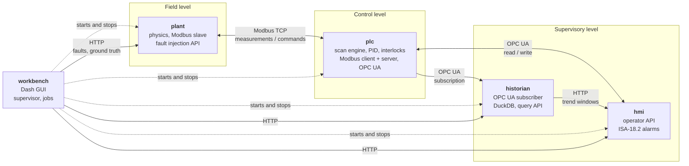

# Architecture

pyplant is four cooperating processes and a GUI that supervises them. They
talk the protocols a real plant uses: Modbus TCP at the field level, OPC UA at
the supervisory level, HTTP above that.



## The processes

| process | module | role | listens on |
| --- | --- | --- | --- |
| plant | `pyplant.services.plant` | Integrates the two-tank physics in real time. A Modbus slave, like a field device. Also serves the fault injection API. | Modbus, HTTP |
| plc | `pyplant.services.plc` | Polls the plant, runs the control program at a fixed scan rate, writes actuator commands. Serves the process image upward over Modbus and OPC UA. | Modbus, OPC UA |
| historian | `pyplant.services.historian` | Subscribes to the PLC over OPC UA and stores samples by exception in DuckDB. The only process that writes the database; everyone else queries it over HTTP. | HTTP |
| hmi | `pyplant.services.hmi` | Operator page and JSON API: live values, setpoint and mode writes, alarm management, trends. | HTTP |
| workbench | `pyplant.workbench.app` | The Dash GUI. Starts and stops the four services, drives them over HTTP, generates datasets and trains detectors in background processes. | HTTP |

Default ports for a workspace with base port 5400:

| port | service | protocol |
| --- | --- | --- |
| 5400 | plant | Modbus TCP |
| 5401 | plant | HTTP, fault API (`/docs`) |
| 5402 | plc | Modbus TCP |
| 5403 | plc | OPC UA, `opc.tcp://127.0.0.1:5403/pyplant/` |
| 5404 | historian | HTTP, query API |
| 5405 | hmi | HTTP, operator page |
| 8050 | workbench | HTTP |

## Data paths

**Control.** The plant publishes six measurements into its Modbus holding
registers. Every 100 ms the PLC reads them in two block transactions, executes
the program against that frozen input image, and writes the valve and pump
commands back. The plant applies whatever is in its command registers on its
next 50 ms integration step. If the PLC stops, the last command persists, as a
real valve's would.

**Supervisory.** The PLC mirrors the plant's measurements into its own store
beside its faceplate, diagnostics and alarm bits, and serves all of it over OPC
UA. The historian subscribes; the HMI reads and writes.

**Operator writes.** A setpoint written in the HMI goes over OPC UA into the
PLC's operator block, which the PLC reads on its next scan. The PLC never
writes that block.

**Faults.** Injected through the plant's own HTTP API and applied inside the
physics stepper. Nothing above the plant is told; the only way to find a fault
is to observe its effect, which is the problem a diagnosis model faces.

**Training.** A separate path entirely. The fast runner drives the same
physics and the same PLC program with no network and no clock, at roughly 1900
times real time, so a dataset of 58 one-hour runs takes minutes.

## Design rules

These hold across the codebase, and most of them exist because a bug proved
they were needed. [DESIGN_NOTES.md](DESIGN_NOTES.md) has the stories.

**One source of truth for every signal.** `pyplant/tags.py` declares every tag
once: units, span, scale factor, Modbus address, owner, alarm limits, OPC UA
path. Every other module imports from it. A scale factor written anywhere else
is a bug waiting for a mismatch.

**Every tag has one owner, and every block has one writer.** Owners are
`PLANT`, `PLC`, `OPER` (the operator) and `ML`. A block written by two parties
loses updates in the gap between a read and a write, which is why the
operator's setpoint lives in a different block from the PLC's readback of it.

**Reads and writes are by block, never by tag.** One Modbus transaction for six
measurements, not six. A partial block write is refused rather than leaving a
stale word beside a fresh one.

**The OPC UA server is a view of the PLC's store, not a second copy.** Values
flow outward on a refresh tick and client writes flow back in. Writable tags
track the last value seen in the store, so a refresh running between a client
write and its handler cannot revert the write.

**Exactly one process writes the historian database.** DuckDB takes an
exclusive lock, and a historian is a service you query, not a file you share.

**The workbench holds no process state.** Every value it shows came from a
service a moment ago. There is no cached copy of the plant to disagree with the
real one, and no physics or threshold inside a callback.

**Faults enter in the stepper, not the physics.** `Simulation.integrate()`
applies them, so a fault behaves identically in a training run and on the live
plant. `sim.true_measurements` is what the instruments would read if none were
lying; `sim.measurements` is what the control system sees.

**Two drivers, one program.** Dataset generation and the live plant run the
same `Program` object against the same physics. Only the clock and the
transport differ.

## The address plan

Generated from `pyplant/tags.py`; the import-time checks there reject gaps,
overlaps and owner mismatches.

| block | registers | owner | tags |
| --- | --- | --- | --- |
| `PLANT_MEAS` | HR 0–5 | PLANT | `LT101`, `LT102`, `FT101`, `FT102`, `PT101`, `ZT101` |
| `PLANT_STATUS` | COIL 0 | PLANT | `PMP101_RUN` |
| `PLC_CMD` | HR 10 | PLC | `FCV101_OP` |
| `PLC_CMD_BITS` | COIL 10 | PLC | `PMP101_CMD` |
| `OPER_SP` | HR 20–21 | OPER | `LIC101_SP`, `LIC101_MAN_OP` |
| `OPER_CMD` | COIL 11–13 | OPER | `LIC101_AUTO`, `CMD_ALM_RESET`, `CMD_PMP101_START` |
| `PLC_FACE` | HR 22–24 | PLC | `LIC101_PV`, `LIC101_OP`, `LIC101_ERR` |
| `PLC_DIAG` | HR 30–32 | PLC | `SCAN_MS`, `SCAN_OVERRUNS`, `PLC_HEARTBEAT` |
| `PLC_ALARMS` | COIL 20–23 | PLC | `ALM_LT101_HI`, `ALM_LT101_LOLO`, `ALM_PT101_HIHI`, `ILK_PMP101` |
| `ML_RESULT` | HR 40–42 | ML | `HEALTH_INDEX`, `TOP_CONTRIB`, `ML_HEARTBEAT` |
| `ML_ALARMS` | COIL 30 | ML | `ALM_HEALTH` |

The `ML` blocks are declared but have no publisher yet; see the roadmap in the
README. The HMI lists their tags as `missing` rather than failing.

## Source layout

```
pyplant/
├── tags.py              tag dictionary, wire codec, address plan
├── clock.py             drift-free periodic scheduler
├── core/hybrid_tank.py  plant physics: pure functions, SI units
├── runners/             the stepper, fast and real-time drivers
├── plc/                 PID, PLC program, scan engine
├── net/                 Modbus store and link, OPC UA server and client
├── hist/db.py           DuckDB historian, last-value-carried-forward windows
├── hmi/                 ISA-18.2 alarm state machine, operator API and page
├── faults/              fault models, scenario library and runner
├── ml/                  features, dataset, detectors, evaluation, training
├── services/            the four process entry points
└── workbench/           workspace, job runner, supervisor, clients, GUI
```

## Extending it

**A new tag.** Append it to `_TAG_LIST` in `tags.py` at an address inside an
existing block, or widen the block in `_BLOCK_LIST`. Run `pytest`: holes,
overlaps, owner mismatches, scale overflows and duplicate addresses all fail
there. If the detector should see it, add it to `BASE_TAGS` in
`ml/features.py`. `DIAG_ORDER` is append-only; reordering it changes the
meaning of every stored `TOP_CONTRIB` value.

**A new fault.** Subclass `ParameterFault`, `SignalFault` or (for actuator
faults) `Fault` in `faults/model.py`, register it in `FAULT_KINDS`, and add a
library entry in `faults/scenarios.py` so the dataset grid includes it. Decide
which channel physics says should isolate it and add that to
`EXPECTED_CHANNEL` in `ml/evaluate.py`, or leave it unscored and say why.

**A new detector.** Subclass `Detector` in `ml/detector.py` and implement
`_fit_core` and `_reconstruct` (or override `score`), then add it to `METHODS`
and `make_detector`. It inherits thresholding, contributions and the health
index, and appears in the workbench's Model tab automatically.

**A different plant.** Replace `core/hybrid_tank.py` behind the same
`step`/`measure` interface and update the tag dictionary. The runner, PLC,
network layers and detectors do not need to change; the design point and
alarm limits do.
